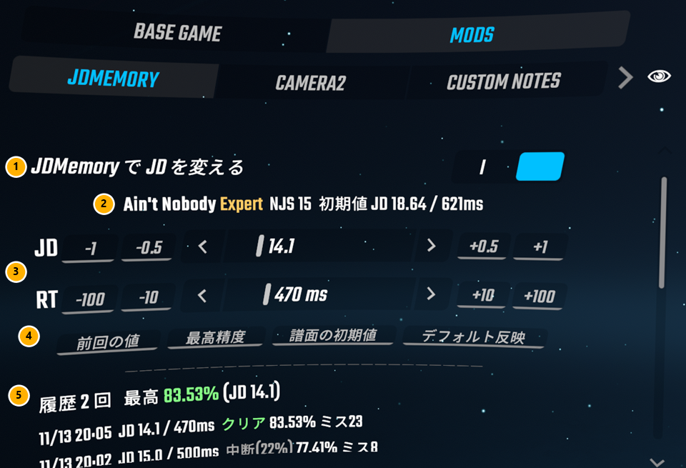
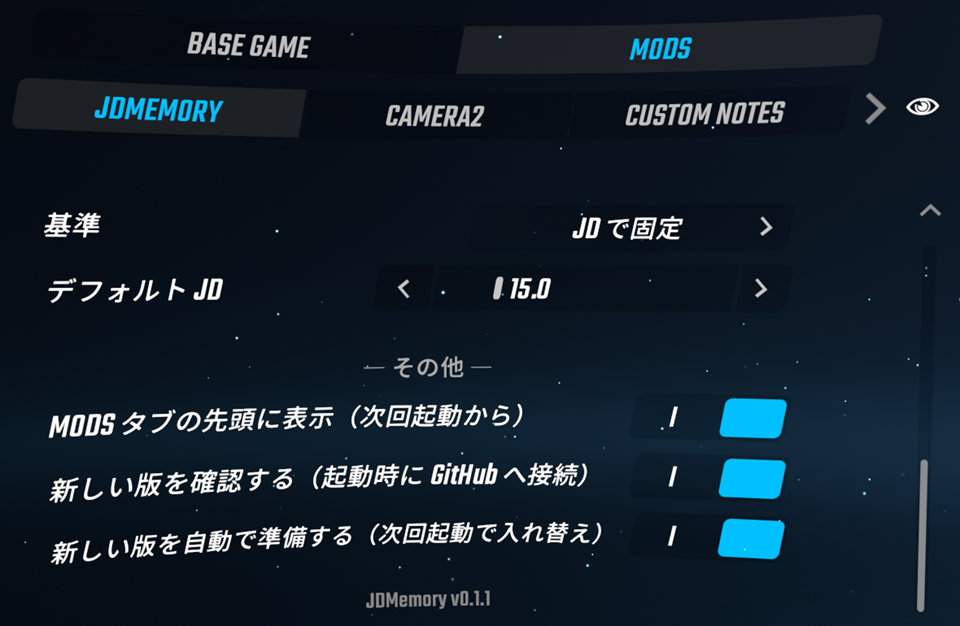

# JDMemory

Beat Saber（PC 1.40.8）用の MOD です。譜面（曲＋モード＋難易度）ごとに、過去に遊んだときの JD（ジャンプ距離）・RT（反応時間）と結果を記録し、それを見ながら今回の値を調整できます。

*A Beat Saber (PC 1.40.8) mod that remembers your jump distance / reaction time per map and difficulty, shows your past settings and results, and lets you adjust the value for this play.*

## 使い方

1. 曲を選ぶ画面で譜面を選び、左のパネルの「MODS」→「JDMemory」タブを開きます（「MODS」の中の一番左にあります）。

   

   - ① **スイッチ**: オンの時、JDMemory が JD を変えます。オフにすると JD は変えずに、履歴の記録だけします
   - ② **選んだ譜面**: 曲名・難易度・NJS と、譜面作者が決めた初期値（JD / RT）
   - ③ **今回の JD と RT**: スライダーか、−1・+0.5 などのボタンで変えます。JD と RT は連動します
   - ④ **ワンタッチ**: 「前回の値」「最高精度」（クリアした中で一番精度が高かった時の JD）「譜面の初期値」「デフォルト反映」
   - ⑤ **この譜面の履歴**: 遊んだ回数、最高精度とその時の JD、日時ごとの JD / RT と結果（クリア・失敗・中断、精度、ミス数）
2. そのまま遊びます。③の JD で始まり、終わると結果が⑤の履歴に加わります（途中でやめた時も、ノーツを1つ以上処理していれば記録します）。
3. 次にその譜面を選ぶと、前回の JD が自動で入ります。履歴を見ながら、自分に合う JD を探してください。

まだ遊んでいない譜面をどの JD で始めるか（デフォルト設定）と、その他の設定は、タブを下に送ると出ます。一番下に今の版が出ます。



## できること

- 曲選択画面の左パネル「MODS」→「JDMemory」タブに、選んだ譜面の情報と履歴を表示
  - 譜面の初期値（JD / RT / NJS）
  - 直近の履歴（日時・JD・RT・クリア/失敗/中断・精度・ミス数・曲の速さ・練習かどうか）
  - 履歴の回数と、クリアした中での最高精度とそのときの JD
- 今回の JD を調整（JD と RT のスライダーは連動）
  - スライダーの刻み: JD 0.05 / RT 5 ms
  - 一括ボタン: JD −1 / −0.5 / +0.5 / +1、RT −100 / −10 / +10 / +100 ms（結果はスライダーの刻みに揃える）
  - 「前回の値」「最高精度」「譜面の初期値」ボタンでワンタッチ設定
- 譜面を選び直すと、その譜面で最後に遊んだ JD が自動で入る
- デフォルト設定（オン／オフ切り替え可）
  - オン：未プレイの譜面はデフォルト値で遊ぶ。基準は「JD で固定」か「RT で固定」（NJS から JD を計算）を選べる
  - オフ：未プレイの譜面は譜面の初期値で遊ぶ
  - 一度遊んだ譜面は、その譜面ごとの値が優先される
  - 「デフォルト反映」ボタンで、デフォルト値をその譜面に当てはめられる
- MODS タブの並びで JDMemory を先頭に表示（タブ内の設定でオフにできる。切り替えは次回起動から反映）
- 途中でやめた（中断・やり直し）プレイも、ノーツを1つ以上処理していれば記録する（進んだ割合とその時点の精度つき）
- ソロ・練習モードが対象（マルチ・キャンペーン・リプレイ再生は記録しない、JD も変えない）

## 必要な物

- Beat Saber（PC 版）**1.40.8**。ほかの版では動作を確かめていません
- MOD を入れた状態（BSManager や Mod Assistant で MOD を入れていれば OK）
- 前提 MOD: **BSML**（BeatSaberMarkupLanguage）・**SiraUtil**（BSManager の MOD の画面で入れられます）

## インストール

### インストーラーで入れる（おすすめ）

1. [最新のリリース](https://github.com/Oz-Co-two/JDMemory/releases/latest) から `JDMemoryInstaller.exe` をダウンロードして起動します。
   「Windows によって PC が保護されました」と出たら、「詳細情報」→「実行」を押してください（個人が作ったアプリで、コード署名をしていないためです）。
   - 警告を出さずに開きたい時は、起動する前に `JDMemoryInstaller.exe` を右クリック →「プロパティ」→「全般」タブの一番下の「許可する」にチェック →「OK」としてください。
   - インストーラーは一度開くと自分の「インターネットから来たファイル」の印を外すので、2回目からは警告が出ません。
2. 見つかった Beat Saber（BSManager・Steam・Meta）が一覧に出ます。入れる先を選びます。
   見つからない時は「フォルダを選ぶ」で Beat Saber のフォルダ（Beat Saber.exe がある所）を選んでください。
3. ゲームの版・前提 MOD を確かめた結果が出ます。「インストール」を押します（ゲームは終了しておいてください）。
4. ゲームを起動すると、曲を選ぶ画面の左のパネルの「MODS」に「JDMemory」のタブが出ます。

### 手で入れる

1. リリースの `JDMemory-v〇.〇.〇.zip` をダウンロードします。
2. **展開する前に**、zip を右クリック →「プロパティ」→「全般」タブの一番下の「許可する」にチェック →「OK」とします
   （ダウンロードしたファイルに付く「インターネットから来たファイル」の印を外すためです。印が残ったまま展開すると、中の DLL にも印が引き継がれます）。
3. 展開して、中の `Plugins\JDMemory.dll` を Beat Saber のフォルダの `Plugins` に入れます。

## 困った時

- **インストーラーを開くと「Windows によって PC が保護されました」と出る**: 「詳細情報」→「実行」で開けます。
  先に exe を右クリック →「プロパティ」→「許可する」にチェックしておくと、警告そのものが出ません。
- **ウイルス対策ソフトに止められる**: 署名の無い新しい exe は誤って止められることがあります。ソースコードは GitHub で公開しています。
  気になる時は「手で入れる」の方法で入れてください。
- **JDMemory のタブが出ない**: インストーラーで入れる先を選び、ゲームの版（1.40.8）と前提 MOD（BSML・SiraUtil）が揃っているか確かめてください。
  手で入れた時は、上の「許可する」の手順をしてから入れ直してください。

## 更新

- **ゲームの中で自動で更新**: ゲームの起動中に1回だけ GitHub を確認し、新しい版があれば取得して、公開された物と一致するか（SHA-256・サイズ・中の DLL の版）を確かめてから
  置いておきます。タブの一番上に「新しい版 v〇.〇.〇 を準備しました。次にゲームを起動すると入れ替わります」と出て、次の起動で入れ替わります
  （MOD を読み込む仕組み BSIPA の、次の起動で入れ替える仕組み `IPA\Pending` を使います）。
  - 入れ替えたくない時は、タブの「入れ替えを取り消す」を押してください。
  - 今のゲームの版が新しい版の対象に入っていない時は、自動では入れず「新しい版があります」と知らせるだけです。
  - タブの一番下の「その他」で、確認そのもの（「新しい版を確認する」）と自動の準備（「新しい版を自動で準備する」）をそれぞれオフにできます。
- **インストーラーで更新**: インストーラーを起動して「更新」を押します。インストーラーは GitHub の最新版を確かめ、新しい版があればその場で取得して照合してから入れます。
- 履歴と設定は更新しても残ります。
- 今入っている版は、タブの一番下（「その他」の下）の「JDMemory v〇.〇.〇」で確かめられます。

## アンインストール

インストーラーで入れた先を選んで「アンインストール」を押します。履歴（これまでの JD・RT と結果の記録）を残すか消すかを選べます。
手で消す時は `Plugins\JDMemory.dll` を消してください（履歴は `UserData\JDMemory\`、設定は `UserData\JDMemory.json`）。

## データと通信

- 履歴は `UserData\JDMemory\history.json` に保存されます（保存のたびに `history.json.bak` も作られます）。
- 通信するのは GitHub（新しい版の確認と、更新のダウンロード）だけです。あなたのデータをどこかへ送ることはしません。

## ほかの MOD との関係

- **JDFixer**: 同時にオンにした場合は JDMemory の値が優先されます（タブに注意が出ます）。どちらか一方だけをオンにするのがおすすめです。
- MODS タブの並びで JDMemory を一番左に出します（タブの「その他」でオフにできます。切り替えは次回起動から）。

## ビルド

.NET SDK があれば `dotnet build -c Release` でビルドできます。外部の NuGet パッケージは使わず、ゲームフォルダの DLL を直接参照します。

MOD 入りの Beat Saber フォルダを、次のどちらかで指定してください。

- `JDMemory.csproj.user` を作って `BeatSaberDir` を書く（リポジトリには含めない）

  ```xml
  <Project>
    <PropertyGroup>
      <BeatSaberDir>（Beat Saber のフォルダ）</BeatSaberDir>
    </PropertyGroup>
  </Project>
  ```

- または `dotnet build -c Release -p:BeatSaberDir="（Beat Saber のフォルダ）"`

出力: `bin/Release/JDMemory.dll`

### インストーラーとリリース

- インストーラー（`installer/`）は MOD をビルドした後に `dotnet build installer/JDMemoryInstaller.csproj -c Release` でビルドします（MOD の DLL を中に入れます）。
- リリースに添付する物は `powershell -ExecutionPolicy Bypass -File tools/make_release.ps1` で `dist/release/` に作ります
  （`JDMemory-v〇.〇.〇.zip`・`JDMemoryInstaller.exe`・`update.json`。インストーラーと同じ検査に通してから終わります）。
- 版の定義元は `Directory.Build.props`。`manifest.json` の `version` と `CHANGELOG.md` の先頭の版もそろえてください。

## ライセンス

Copyright (C) 2026 Oz-Co2

[GNU General Public License v3.0](LICENSE) またはそれ以降のバージョン（GPL-3.0-or-later）

This program is free software: you can redistribute it and/or modify it under the terms of the GNU General Public License as published by the Free Software Foundation, either version 3 of the License, or (at your option) any later version.

## 謝辞

どのゲーム内部の処理に手を入れれば JD を変えられるかは、[JDFixer](https://github.com/zeph-yr/JDFixer)（by Zephyr）を参考にしました。JDFixer のコードはコピーしておらず、JD の計算はゲーム本体の計算式から独自に実装しています。
